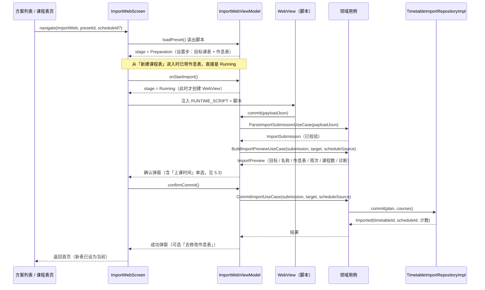

## 1. 背景与目标

教务系统导入解决的是「把学校教务系统里的课表搬到应用里」这件事。

它和 CSV 导入的差别不只是入口不同，而是**数据要先从别人的网页里取出来**：

- 教务系统通常只报告「第几节」（`第 1-2 节`），**不报告上课时间**；所以一个课表必须关联一个作息表，应用不会替用户编时间。
- 取数要登录、要翻多个接口，每个学校的系统都不一样，因此**取数逻辑不能写死在应用里**。
- 脚本在用户的登录会话里运行，所以它必须被当作**不可信输入**对待，写库前必须让用户看到将要写入的内容。

于是整条链路被拆成三段，各自可以独立替换：

| 段 | 回答什么问题 | 在哪 |
| --- | --- | --- |
| 预设（preset） | 从哪来、叫什么、起始网址 | `data/importer/`、`domain/model/importer/` |
| 脚本（script） | 怎么取数、字段在哪 | 远端脚本，跑在 WebView 里 |
| 载荷（payload） | 取出什么 | 由 `domain/usecase/importer/` 校验并落库 |

### 1.1 这份文档覆盖什么

导入功能由下面这些能力组成，每项对应本文的一节。看代码前先看这张表，比自上而下读源码快得多。

| 能力 | 用户看到的东西 | 关键实现 | 对应章节 |
| --- | --- | --- | --- |
| 预设来源与合并 | 方案列表（按学校分组、可搜索） | `ImportPresetRepositoryImpl` | 5.1 |
| 计划与预览一致 | 确认弹窗里的每个数字 | `ImportPlanResolver` | 5.2 |
| 上课时间与作息表 | 确认弹窗的「上课时间」单选 | `ImportScheduleSource` | 5.3 |
| 越界与重叠诊断 | 弹窗里的三条提示 | `ImportDiagnostics` | 5.4 |
| 在 WebView 里跑脚本 | 导入页、地址栏、UA 切换 | `ImportWebScreen` / `SleepInBridgeHost` | 5.5 |
| 源导入（设备端组装） | 「从链接导入源」「从本地目录导入源」 | `ImportedSourceImporter` | 5.6 |
| 复用本地缓存的族 | 编辑器里的「脚本来源」二选一 | `CachedFamilyRepository` | 5.7 |
| 手动 DI 接线 | —— | `RepositoryModule` / `SleepInApplication` | 5.8 |

## 2. 相关模块与文件位置（先看树）

```text
app/src/main/java/com/kurosu/sleepin/
├─ domain/model/importer/
│  ├─ ImportPreset.kt                    # 预设模型 + ImportPresetSourceKind（来源种类）
│  ├─ ImportPresetSchool.kt              # 学校元数据与稳定内部 ID（customSchoolIdForName）
│  ├─ CustomImportPreset.kt              # 自定义预设的存储模型
│  ├─ ImportSourceModels.kt              # 源导入模型（ImportSourceDraft / FamilyAssembly*）
│  └─ ImportSourceDefaults.kt            # 内置源地址与刷新周期边界
├─ domain/repository/
│  ├─ ImportPresetRepository.kt          # 预设读取接口
│  ├─ TimetableImportRepository.kt       # 导入计划（TimetableImportPlan）与结果
│  ├─ ImportSourceRepository.kt          # 「导入一个源」的接口
│  └─ LocalFamilyRepository.kt           # 「列出 / 组装本地缓存的族」的接口
├─ domain/usecase/importer/
│  ├─ ImporterModels.kt                  # 载荷 draft / 已校验模型（ImportSubmission 等）
│  ├─ ParseImportSubmissionUseCase.kt    # 载荷契约的唯一校验点
│  ├─ ImportPlanResolver.kt              # 「这次导入写到哪、用哪个作息表」的唯一解析点
│  ├─ BuildImportPreviewUseCase.kt       # 确认弹窗需要的全部数字与文案
│  ├─ CommitImportUseCase.kt             # ImportTarget / ImportScheduleSource + 落库入口
│  ├─ ImportDiagnostics.kt               # 越界与时段重叠诊断（只提示，不拦截）
│  ├─ ImportWeekRule.kt                  # 周次数组 → WeekType/startWeek/endWeek/customWeeks
│  ├─ GetImportPresetsUseCase.kt         # 读出全部预设
│  ├─ ReadImportScriptUseCase.kt         # 读出某个预设的脚本
│  ├─ Add/Update/RemoveCustomImportPresetUseCase.kt
│  ├─ CustomImportPresetValidation.kt    # 自定义方案表单的校验
│  ├─ ImportSourceUseCase.kt             # 导入一个源（链接或本地目录）
│  ├─ ChangeImportSourceUrlUseCase.kt    # 改源地址（先导新的，再忘旧的）
│  ├─ ForgetImportSourceUseCase.kt       # 删除自建源（连脚本目录一起清）
│  ├─ GetRegisteredImportSourcesUseCase.kt  # 列出已登记的源
│  ├─ RenameImportSourceUseCase.kt      # 给源起名（名字跟着源存，删源时一起没）
│  ├─ RefreshImportSourcesUseCase.kt     # 刷新所有源（首次启动 + 定期，含「是否到期」判定）
│  └─ ReuseLocalFamilyUseCase.kt         # 列可用族 + 用缓存族组装脚本
├─ data/importer/
│  ├─ ImportPresetSource.kt              # 来源接口（导入源、自定义、调试样例都实现它）
│  ├─ CustomImportPresetStore.kt         # 用户自定义预设（可写来源）
│  ├─ CustomImportPresetCodec.kt         # 自定义预设的 JSON 编解码
│  ├─ ImportPresetFileStore.kt           # 自定义预设的脚本文件读写（含路径逃逸防护）
│  ├─ ImportPresetPaths.kt               # 预设 id 与脚本路径规则（安全边界）
│  ├─ ImportPayloadParser.kt             # 载荷 JSON → draft（只解码，不判业务）
│  ├─ ImportScriptTextDecoder.kt         # 脚本文本解码（编码兜底）
│  ├─ ImportSourceIndexParser.kt         # source-index.json（schema v2）解析
│  ├─ ImportSourceReader.kt              # 「字节从哪来」：HTTPS 与 SAF 目录两种实现
│  ├─ ImportedSourceImporter.kt          # 一次导入的全部规则（与来源无关）
│  ├─ ImportSourceAssembler.kt           # 合并取值 + 拼装最终脚本
│  ├─ ImportSourceFileStore.kt           # 源缓存目录（runner / 族 / 组装出的脚本）
│  ├─ RemoteImportPresetStore.kt         # 源导入方案的元数据（ImportedPresetRegistry 实现）
│  └─ CachedFamilyRepository.kt          # 用本地缓存族组装（LocalFamilyRepository 实现）
├─ data/repository/
│  ├─ ImportPresetRepositoryImpl.kt      # 多来源合并
│  ├─ TimetableImportRepositoryImpl.kt   # 单事务落库（课表 + 课程 + 可选新建作息表）
│  └─ ImportSourceRepositoryImpl.kt      # 选 reader + 源标识，其余交给导入器
├─ ui/screen/importer/
│  ├─ ImportPresetListScreen.kt          # 方案列表（按学校分组 + 字母索引、搜索、管理入口）
│  ├─ ImportPresetListViewModel.kt / ImportPresetListFilter.kt
│  ├─ ImportPresetDirectoryRows.kt       # 列表行模型与字母锚点（纯逻辑，可单测）
│  ├─ ImportSourceListScreen.kt / ViewModel  # 方案源清单：自建源可改地址/重命名/删除，内置源只读
│  └─ ImportPresetEditorScreen.kt / ViewModel / ImportPresetEditorForm.kt   # 自定义方案编辑
├─ ui/screen/importer/web/
│  ├─ ImportWebScreen.kt                 # 导入页（设置步 + WebView + 悬浮执行按钮 + 弹窗）
│  ├─ ImportWebViewModel.kt              # 阶段机、桥请求处理、确认与落库编排
│  ├─ SleepInBridgeProtocol.kt           # 桥的线格式与安全规则（纯 Kotlin，可单测）
│  ├─ SleepInBridgeHost.kt               # WebView 侧：注入、转发、回填
│  ├─ ImportDialogHost.kt                # 脚本弹窗（alert/prompt/choose）的渲染
│  ├─ ImportWebViewFactory.kt / ImportUserAgent.kt / ImportSetupSelection.kt
├─ importer/                             # 内置方案源的 OS 集成（WorkManager）
│  ├─ ImportSourceRefreshScheduler.kt    # 启动时一次 + 按设置周期
│  └─ ImportSourceRefreshWorker.kt       # 后台执行一次刷新
├─ di/RepositoryModule.kt                # 手动 DI：预设来源、导入仓储
└─ SleepInApplication.kt                 # 手动 DI：全部 use case 实例

app/src/main/res/xml/network_security_config.xml   # 明文 HTTP 只放行 .edu.cn
app/src/debug/java/.../data/importer/              # 调试用模拟导入（仅 debug，见第 6 节）
app/src/release/java/.../data/importer/            # 同名的空实现（release 不打包该功能）
```

## 3. 数据契约：脚本产出什么

脚本通过桥交回一份 JSON，形状固定如下（`schema` 之外的字段都可省略）：

```json
{
  "schema": 1,
  "timetable": { "name": "2025 秋", "totalWeeks": 18, "startDate": "2025-09-01" },
  "periods": [
    { "period": 1, "start": "08:00", "end": "08:45" },
    { "period": 2, "start": "08:55", "end": "09:40" }
  ],
  "courses": [
    {
      "name": "高等数学",
      "teacher": "某老师",
      "note": null,
      "color": null,
      "sessions": [
        { "day": 1, "from": 1, "to": 2, "location": "某楼 101", "weeks": [1, 2, 3] }
      ]
    }
  ]
}
```

`day` 是 1-7（1 = 周一），`from`/`to` 是节次号，`weeks` 是**周次数组**而不是区间字符串。

契约由 `ParseImportSubmissionUseCase` 一处把关，它拒绝的情况包括：

| 字段 | 规则 |
| --- | --- |
| `schema` | 必须是 1（新增可选字段不需要升版本，因为解析器忽略未知键） |
| `courses` | 必须有且非空，上限 1000 门 |
| `courses[i].sessions` | 必须有且非空 |
| `day` / `from` / `to` | `day` 在 1-7；节次 ≥ 1；`to ≥ from`；`to ≤ MAX_SUPPORTED_PERIOD_NUMBER`（60，见 `domain/model/TimetableLimits.kt`） |
| `weeks` | 非空且都 ≥ 1（排序去重在这里完成） |
| `timetable.totalWeeks` | 1 - `MAX_SEMESTER_WEEK_COUNT`（30） |
| `timetable.startDate` | `yyyy-MM-dd` |
| `periods` | 可选；给了就必须完整：`period` 在 1-60 且不重复，`start`/`end` 形如 `HH:mm`（容忍 `8:00`），`end` 晚于 `start` |

`periods` 是**可选**的，因为它回答的是「这个教务系统是否顺带给了上课时间」：

- 给了 → 确认弹窗里多一个「用方案提供的（新建作息表）」选项（见 5.3）。
- 没给 → 用户只能选一个已有作息表，应用不会替它编时间。

**故意不在这里校验的两件事**（它们是「不匹配」，不是错误，见 5.4）：

- 课程引用的节次是否在目标作息表里定义过；
- 周次是否在学期总周数之内。

### 3.1 桥 API

脚本能调用的方法由 `SleepInBridgeProtocol.RUNTIME_SCRIPT` 定义，注入页面后挂在两个全局对象上：

| 调用 | 作用 |
| --- | --- |
| `window.sleepinBridge.toast(message)` | 状态提示，不等结果 |
| `window.sleepinBridge.finish()` | 脚本结束，可以关闭导入页 |
| `await window.sleepinBridgePromise.alert({ title, message, confirmText })` | → `true` / `false` |
| `await window.sleepinBridgePromise.prompt({ title, hint, initialValue, validate })` | → 文本 / `null`；`validate` 是页面里的函数名，由应用回填调用 |
| `await window.sleepinBridgePromise.choose({ title, options, defaultIndex })` | → 下标 / `null` |
| `await window.sleepinBridgePromise.commit(payload)` | → `true` 表示确实写入了 |

### 3.2 桥的安全规则（不是可选项）

页面能调用一个原生对象，所以宿主侧是攻击面。所有规则集中在 `SleepInBridgeProtocol`：

- 每条消息必须带合法的 `callId`（固定字符集与长度），否则整个请求被拒——因为回填时要把 id 嵌进脚本。
- 回填脚本由 Kotlin 拼装（`buildResolveScript` / `buildValidateScript`），**页面永远不提供脚本文本**。
- 原始消息大小、等待中的请求数、选项个数都有上限（4 MiB / 32 / 32）。
- 每个字段在解码时就补默认值或夹取范围，弹窗层不再二次校验。
- 页面导航会清空未决请求队列：旧文档的 promise 已经死了，留着只会让用户回答不再存在的问题。

## 4. 导入全流程（总览）



三个值得注意的顺序：

- **WebView 在设置步之后才创建**。`ImportWebUiState.stage()` 返回 `Loading / Preparation / Running`，而 WebView 只在 `Running` 存在。原因是它只会被创建一次：早创建就会拿到当时的状态（对带起始网址的预设，等于一个永远变不成教务系统的空文档）。
- **设置步可以被入口跳过**。从「新建课程表」进入时，作息表已经作为路由参数传进来了（`ImportWebViewModel` 的 `chosenScheduleId`），
  所以 `isStarted` 初始就是 `true`，`stage()` 直接返回 `Running`，目标固定为 `ImportTarget.NewTimetable`；
  设置页入口不带作息表，因此必须先把目标与作息表选完才能开始。
- **确认弹窗的数字与写入用的是同一次解析**。见 5.2。

## 5. 关键实现细节

### 5.1 预设来源与合并顺序

`ImportPresetRepositoryImpl` 把多个来源合并成一份列表，**后来者覆盖同 id 的预设**。
应用**不内置任何方案**：APK 里没有预设索引，也没有预拼装的脚本。所以一台新设备上列表必然是空的，
里面的每一条要么来自用户导入的源，要么是用户自己写的。

| `ImportPresetSourceKind` | 来源 | 说明 |
| --- | --- | --- |
| `DEBUG` | `debugImportPresetSources()` | **只在 debug 构建存在**的模拟预设（见第 6 节） |
| `CUSTOM` | `CustomImportPresetStore` | 用户自己导入的脚本；也是唯一的可写来源 |
| `REMOTE` | `RemoteImportPresetStore` | 用户导入的*组装源*（链接或本地目录，见 5.6）：App 读源文件后在设备上生成最终脚本，平台只读 |

内置的社区源也是 `REMOTE`：它只是把同一个链接固定下来、由应用自己去导入与刷新（见 5.9）。

合并规则与两个约束：

- 预设只记录**来源种类**，所以每种来源最多注册一个实例（`readScript` 会按种类找到那一个来源）。正因为这条，模拟预设用了独立的 `DEBUG` 种类，而不是冒充导入源。
- 预设 id 与脚本路径由 `ImportPresetPaths.kt` 统一约束：id 必须是小写 slug。外部数据（源索引）里出现的路径则由 `ImportSourceIndexParser` 校验为安全相对路径，再用文件哈希绑定内容。
- 学校分组用的是**规范化学校名生成的内部 ID**（`customSchoolIdForName`），官方学校代码只用于搜索与显示。

### 5.2 计划只解析一次

`ImportPlanResolver` 是「写到哪张课表、叫什么名字、总周数多少、用哪个作息表」的**唯一**实现，`BuildImportPreviewUseCase`（确认弹窗）与 `CommitImportUseCase`（真正写入）都走它。

这样做的原因很直接：如果两处各自解析，弹窗可能描述 A、实际写入 B，而用户是**根据弹窗做出决定**的。

### 5.3 上课时间从哪来

`CommitImportUseCase.kt` 里的 `ImportScheduleSource` 表达用户的两种选择：

| 取值 | 含义 |
| --- | --- |
| `Existing(scheduleId)` | 用用户已有的作息表（`scheduleId <= 0` 表示「保持目标课表现有的作息表」，只在覆盖模式有意义） |
| `FromPayload` | 用脚本报回的 `periods` **新建**一个作息表 |

- **在哪里问用户**：确认弹窗。只有脚本跑完才知道它到底有没有报时间，所以问题放在这一屏；`ImportPreview.importedPeriodCount == 0` 时**不显示这个单选**，免得给出一个必须被拒绝的选项。默认选 `FromPayload`（教务系统自己的时间比碰巧被选中的模板更接近事实）。
- **切换选项会重建预览**（`ImportWebViewModel.onScheduleSourceSelected`），而不是打补丁——保证弹窗里任何一组数字都来自一次完整的解析。
- **新建作息表与导入课程在同一个事务里**（`TimetableImportRepositoryImpl.resolveScheduleId`）。失败时不会留下一个孤儿作息表。计划里的 `ImportScheduleDraft` 只带时刻，`scheduleId` 由仓储在写入时分配。
- **`TimetableImportResult.Imported` 会带回生效的 `scheduleId`**：新建的作息表 id 只有写入之后才存在，而成功弹窗里的「去修改作息表」必须指向用户最终得到的那张表。
- 新建作息表的默认名字是 `导入的作息表`（`ImportPlanResolver.DEFAULT_SCHEDULE_NAME`），与课表默认名 `导入的课程表` 对称，方便用户在作息表列表里认出它。

覆盖模式下还有一个细节：选「覆盖已有课程表」时，作息表下拉会**默认跟随目标课表自己的作息表**（`ui/screen/importer/web/ImportSetupSelection.kt` 的 `chooseOverwriteTarget`）。替换课程不等于要改上课时间。

### 5.4 越界与诊断：提示，但不拦截

`ImportDiagnostics.kt` 会算出并交给弹窗：

| 诊断项 | 含义 |
| --- | --- |
| `periodsMissingFromSchedule` | 课时用到的、目标作息表没定义的节次；给「去修改作息表」按钮 |
| `weeksOutsideSemester` | 超出课程表总周数的周次（不裁剪，照原样写入） |
| `slotOverlaps` | **载荷内部**两门课占用同一时段同一周次 |

最后一项是刻意这么做而不是复用 `CheckConflictUseCase` 的：**导入是整表替换**（`replaceCourses` 先删光旧课程），所以拿库内已有的课程做冲突预检永远为空；真正会出现的冲突是载荷自己内部的重叠。

这些都不是拦截条件。丢掉它们会丢掉教务系统确实报出来的课，所以选择「照常写入 + 明确告诉用户」。

### 5.5 WebView 里还有什么

- 地址编辑合并进顶部标题栏，执行与帮助控件悬浮在右下角（不占固定高度底栏）。
- 更多菜单可以切换手机版/桌面版 UA（`ImportUserAgent.kt`），切换后刷新。
- 明文 HTTP **只放行 `.edu.cn` 及其子域**（`res/xml/network_security_config.xml`），HTTP 页面上会显示安全警告。
- 重跑脚本会先刷新页面：同一个文档只能被注入一次脚本（顶层 `const` 会让第二次求值直接失败）。

### 5.6 源导入：在设备上组装

源**不再要求发布最终脚本**。源索引（`source-index.json`，`schemaVersion: 2`）只发布：
共享 `runner.js`、每族的 `family.json` + `adapter.js`、学校元数据，以及每个方案的组装声明。
App 拿到后在本机拼出最终脚本，再交给现有的 WebView 执行。

源有**两种来源**，走同一套规则：

| 来源 | 入口 | 读取器 |
| --- | --- | --- |
| 远程链接 | 顶部菜单「从链接导入源」 | `HttpImportSourceReader`：相对路径按索引地址解析，且必须同源 |
| 设备目录 | 顶部菜单「从本地目录导入源」（选目录，不是选文件） | `TreeImportSourceReader`：在授权目录树里按相对路径查找 |

选的是**目录**而不是文件：源索引引用的 runner 与族文件就在它旁边，单文件授权读不到兄弟文件。
目录里必须有 `source-index.json`（`Build-SourceIndex.ps1` 生成的产物）。

三种组装形态（`ImportPresetAssemblyMode`）：

| 形态 | 组成 | 用途 |
| --- | --- | --- |
| `FAMILY` | runner + 族 `changePoints` + adapter + 方案 `config` | 族完全覆盖学校差异 |
| `OVERRIDE` | 上述内容 + 方案 `override.js` | 只有一处逻辑需要学校专属覆盖 |
| `REWRITE` | 方案自己的完整脚本 | 完全异构系统 |

链路与落点：

1. `ImportPresetListScreen`：菜单选来源 → 链接填地址 / 目录走 SAF 目录选择器 → 确认弹窗里勾选
   「优先复用本地已缓存的族」；
2. `ImportPresetListViewModel.importSource()` / `importLocalSource()` → `ImportSourceUseCase`
   （只校验「用户输入得像不像一份源」），两者结果走同一个 `publishImportResult()`；
3. `ImportSourceRepositoryImpl` 只决定**字节从哪来**：选一个 `ImportSourceReader`，并给出源标识与
   脚本目录前缀；
4. `ImportedSourceImporter` 是一次导入的**全部规则**（与来源无关）：读索引 → **逐个校验 SHA-256** →
   取族（可复用缓存）→ 组装 → 写脚本 → 登记；
5. `ImportSourceAssembler` 合并 `changePoints` 与方案 `config`（对象深合并，其余整值替换），
   然后拼成 `(async () => { ... })()` 的自包含脚本；
6. 最终脚本写进 `ImportSourceFileStore`（`files/import-source-cache/`，远程与本地用不同目录前缀），
   方案元数据写进 `RemoteImportPresetStore`（它实现 `ImportedPresetRegistry`，`internal`）；
7. 方案列表通过 `REMOTE` 来源读到它们，点进去仍走原来的 WebView（导入协议未变）。

因为规则只有一份，本地目录导入不会出现「少校验一次哈希」这类只在一条路径上的漏洞；
新增一个来源只需再实现一个 `ImportSourceReader`。

**没变化时什么都不做。** 一次完整导入要为每个方案组装并写出一份脚本（目前 116 份、每份 50KB 上下），
所以拿到索引后先比对 `indexVersion`：与上次登记的一致就直接结束，不下载族文件、不组装、不写盘，
返回 `ImportSourceImportResult.Unchanged`。这是**成功**而不是「跳过了检查」——设备上的方案已经是最新的。

它成立的前提是「内容变则 version 变」：生成器在内容变化时自动递增，CI 的 `-Check` 拦住手改，
所以这个前提由仓库侧保证（见预设仓库 README 的 `indexVersion` 一节）。

> **为什么没用 `If-None-Match`。** 条件请求本可以让「没变化」连索引正文（目前约 90KB）都不用传。
> 实测 `raw.githubusercontent.com` 的 `ETag` **不随内容变化**：同一个 `ETag` 在正文 60KB / 74KB / 88KB
> （`indexVersion` 19 → 22）时都没变，而且带上去仍然回 304。信任它会让用户**永远收不到更新**，
> 所以这条路已撤掉：宁可每周多下一次索引，也不拿「能否拿到更新」去换那几十 KB。

**导入会缓存什么**（不是“用到什么才缓存什么”）：

- 索引声明的**每一个族**（`family.json` + `adapter.js`）与 **runner**，不论本次导入的方案是否引用它们。
  这份缓存就是编辑器「用本地缓存的族组装」的输入，所以“只发布族、还没有方案”的源也必须留下可复用的族。
  反过来说，“没人用的族就不下载”是一个**不能做**的优化：它会让只发布族的源导入后什么都不剩，
  编辑器只能报“本地没有可复用的族”，而提示里说的族数量是索引声明的个数，两个数字对不上；
- 源里声明的族文件缺失或哈希不符会让**整次导入失败**并指明是哪个文件：索引声明了就应当存在，
  而静默跳过部分族比直接报错更难排查（用户会以为族已就绪，直到在编辑器里发现少了几个）。

安全边界（都在代码里，不靠人工约定）：

- 远程只接受 `https://`，且源文件解析后必须与索引同源；本地只接受安全相对路径，越界由目录树授权兜底；
- 每个文件都校验索引声明的 SHA-256（本地导入**同样校验**：否则「改了脚本但忘了重新生成索引」
  会静默组装出另一份脚本）；
- 组装不执行源里的 Kotlin/Android 代码；最终脚本仍作为不可信 JavaScript 在 WebView 里跑，
  沿用现有的桥协议校验与载荷校验；
- App 不内置任何方案；唯一的预置地址是 5.9 的社区源（可以关掉自动更新），除定期刷新外不在启动时联网。

已知限制：

- 族缓存按**族 id** 复用（跨源共享同一个目录）；关掉复用时会用源内文件覆盖同名缓存；
- 重复导入同一来源会替换该来源已登记的方案；源本身的地址与名字在「方案源」页里改（见 5.9）；
- 方案列表只显示方案。一个只有族的源导入后列表仍然为空，此时空状态与导入完成的提示会告知
  「已缓存 N 个族」并指出去 `＋` 里复用。

### 5.7 自己写方案：复用本地缓存的族

「导入自己的脚本」编辑器（右下角 `＋` 进入）现在有两种**脚本来源**：

| 来源 | 用户要提供什么 | 落库 |
| --- | --- | --- |
| 自己写完整脚本 | 一份完整脚本（选文件或粘贴） | 原样存成 `presets/<id>/script.js` |
| 用本地缓存的族组装 | 族 + 取值（JSON，可留空）+ 可选覆盖脚本 | 先组装成完整脚本，再走同一条落库路径 |

关键点：

- 组装用的是**同一个** `ImportSourceAssembler`。从缓存族组出的方案与从源导入的方案必须一模一样，
  否则同一个族会因为“用户怎么得到它”而行为不同；
- **存储层完全不用改**：组装结果作为 `scriptText` 交给现有的 `AddCustomImportPresetUseCase`，
  所以自定义方案的校验、落库、编辑、删除全部照旧；
- 组装实现是 `CachedFamilyRepository`（实现 `LocalFamilyRepository`）+ `ReuseLocalFamilyUseCase`
  （一个方法列可用族，一个方法组装；两者必须描述同一份缓存状态，所以放在同一个用例里）；
- 编辑器的 `scriptSource` 是 `ImportPresetScriptSource`（`WRITTEN` / `FAMILY`），
  `canSave` 只决定按钮可点与否，真正的校验仍在用例里。

**可用族的前提**（否则这个选项就只能“看着有、点不动”）：

- 族只可能来自导入过的源，所以新设备上列表为空；此时 UI 仍然**显示**该选项但置灰，
  并说明“先在方案列表里导入一个源”，而不是把它藏起来；
- “可用”还要求**运行流程也在缓存里**。`ImportedSourceImporter` 每次导入都会读并缓存 runner
  （索引本来就要求声明它）。缓存写入失败不影响导入本身，只是这条可选路径不可用；
- 因此“可用族”的判定写在 `LocalFamilyRepository.availableFamilyIds()` 里（`runner` + `family.json` + `adapter.js`
  三者齐备），而不是留给界面判断。

### 5.8 手动 DI 接线位置

项目暂时不用 Hilt（`app/build.gradle.kts` 里刻意关闭），所以：

- 仓储与来源在 `di/RepositoryModule.kt`：`provideImportPresetRepository` 组装来源列表，`provideTimetableImportRepository` 组装事务写入所需的 DAO，`provideImportSourceRepository` 组装导入器并注入 `ContentResolver`，`provideLocalFamilyRepository` 提供本地缓存族的复用入口。涉及 `internal` 类型的三个 provider 自身也是 `internal`。
- use case 实例在 `SleepInApplication.initGraph()`，通过 `app.xxxUseCase` 传给各 ViewModel 的手动 `Factory`。
- 族文件与最终脚本的本地缓存目录由 `ImportSourceFileStore.DIRECTORY_NAME` 定义，不要在两处各写一个路径。

### 5.9 内置方案源与自动更新

应用**不内置任何方案**，但内置了一个方案源的地址（`domain/model/importer/ImportSourceDefaults.kt`
的 `BUILT_IN_IMPORT_SOURCE_URL`，指向社区仓库的 `source-index.json`）。理由很直接：新装的设备上列表必然为空，
而这应该是「正在获取」而不是「什么都没有」。

它完全复用 5.6 那套导入规则，没有任何特权：

| 环节 | 实现 |
| --- | --- |
| 定时 | `importer/ImportSourceRefreshScheduler`（WorkManager，需要网络） |
| 执行 | `importer/ImportSourceRefreshWorker` → `RefreshImportSourcesUseCase` |
| 到期判定 | `RefreshImportSourcesUseCase.isDue`（纯函数，可单测） |
| 设置 | `AppSettings` 的 `importSourceAutoRefreshEnabled` / `importSourceRefreshIntervalDays` / `importSourceLastRefreshAtMillis` / `importSourceLastRefreshError` |

几个刻意的决定：

- **「该不该刷新」只在 use case 里判定**。两个调用方都拿不到对方的信息：启动时的检查不知道上次什么时候跑的，
  而定期任务不能因为用户调短了周期就把已排好的那次跳过。
- **启动时每次都入队一次，但由 use case 判定是否到期**，而且入队用 `ExistingWorkPolicy.KEEP`，
  所以一天开十次应用仍然只拉一次。
- **失败不推进时间戳**。否则一次碰巧离线的启动会把重试推迟整整一个周期；现在下次启动就会再试，
  同时把错误写进设置，设置页可以复制出来排查。
- **不复用本地缓存的族**（`reuseLocalFamilies = false`）。用户自己的链接可以选，但一个更新机制如果
  留着上一版适配器就毫无意义。
- **它覆盖所有源，不只内置那个**。用户把地址改成镜像、或再加一个仓库，都是他期望被更新的；
  一个写着「自动更新」却只动其中一个的开关是陷阱。本地目录源也包含在内（重新读同一个目录，不走网络）。
- **它和「自动检查更新」一样是后台联网行为**，所以必须是设置项：默认开、默认 7 天，可选 1/3/7/14/30 天；
  设置页还有「立即更新」直接走 use case，以便立即给出反馈。
- **失败按源记录**。一个源坏掉只会让它在下次启动再试，其他源在同一轮里照常更新。
- **内置源的地址是常量，不是设置项**。它在界面上只读：不能改地址、不能重命名、不能删除。
  理由很直接：一个地址输错的源等于把手上的方案弄没，而内置那个没有「恢复默认」可退；
  用户想把应用指向别处，就用「从链接导入源」再加一个源——那是受支持的做法。
  因此 `AppSettings` 里没有源地址字段，刷新用的始终是 `BUILT_IN_IMPORT_SOURCE_URL`。
- **自建源可以改地址**。做法是「先导入新地址，成功后再忘掉旧的」（`ChangeImportSourceUrlUseCase`），
  所以输错一个链接不会把手上能用的源弄丢；忘掉时会连它组装的脚本目录一并删除。
  这条只适用于自建源：内置源不会走到这个 use case。
- **每个自建源都可以自己起名**（`RenameImportSourceUseCase`）。名字跟着源存（`RemoteSourceDto.displayName`），
  所以删源时一起消失；留空就回到根据地址生成的名称——链接用主机名，设备目录用最后一段目录名。
  内置源永远是「内置源」：它不可重命名，标题也不应该能跟它那个固定地址不一致。
  早期版本给所有自建源都写「自建源」，有两个源时完全分不出谁是谁。
- **源的清单是独立一页**（`ImportSourceListScreen`，从 设置 → 教务导入 → 方案源 进入）。
  每一条的行自带动作，其中一个是破坏性的，地址又长，塞在设置里既挤又容易误触。
  **添加源也在这一页**（右下角 ＋）：用户是来这里管源的，把「添加」只放在导入方案页会让他再去找一处。
  两个入口走的是同一个 `ImportSourceUseCase`，带同一个「复用本地族」开关。
  行首图标按**来源形式**区分（链接 / 设备目录），标题按**名字**区分（自定义名 / 回退到主机名或目录名）——
  这是两件不同的事，混成一个「自动更新 / 手动添加」会让两行没法直接比较。
- **只有自建源能删**。内置源是一个固定的槽位：它在任何导入发生之前就存在，地址写死在应用里，
  删了下次刷新也会把它带回来；要停就关掉「自动更新方案源」（`ForgetImportSourceUseCase` 的 KDoc 里写了这一点）。

注意仓库侧目前返回的 116 条方案大多标着「占位条目：……尚未适配」。这是仓库的状态而不是应用的问题：
占位只表示学校在册，应用照原样展示（包括 `description` 里的那句说明）。

## 6. 调试用模拟导入（仅 debug 构建）

导入流程平时需要真实教务系统、真实登录和一份真实课表才能跑通，这使得**与学校无关的那部分**（设置步、桥、确认弹窗与作息表单选、越界诊断、落库）很难随手验证。

为此 debug 构建里多了一个预设「模拟导入（仅调试版）」：

- 它不访问任何网站（起始网址为空，开一个空白页），脚本直接产出样例载荷；
- 它走的是**和真脚本完全相同**的那条路：注入运行流程 → 调桥 → 校验载荷 → 确认弹窗 → 落库。所以在这里跑通，说明导入链路本身没有问题，剩下的只是取数。
- 脚本会让你选一个数据集，分别对应三种需要人工确认的行为：
  1. **标准样例（含作息时间）**——验证作息表单选与「新建作息表」；
  2. **不提供作息时间**——单选不应出现，只能使用已有作息表；
  3. **单双周 + 越界节次**——同一时段的奇偶周应被合并，超出作息表的节次应被提示且可以跳去补全。

它的实现分散在按构建类型分开的源集里，**release 版本不包含这些代码**：

```text
app/src/debug/java/com/kurosu/sleepin/data/importer/
├─ ImportSamplePresetSource.kt   # 模拟预设与它的脚本（脚本文案也在这里）
└─ DebugImportPresets.kt         # debugImportPresetSources() = 上面这个来源
app/src/release/java/com/kurosu/sleepin/data/importer/
└─ DebugImportPresets.kt         # 同名函数，返回空列表
```

`di/RepositoryModule.provideImportPresetRepository` 只能看到 `debugImportPresetSources()` 这个函数名，具体返回什么由构建类型决定。这是「release 真的不打包」而不是「release 里有但走不到」：脚本字符串根本没有被编译进 release 的 dex。

用法见 `docs/SleepIn-Docs/docs/dev/1.build-debug/1.build-debug-windows.md`。

## 7. 常见问题与排错

### 7.1 方案列表是空的

应用**不内置任何方案**（见 5.1），正常情况下列表靠 5.9 的社区源自动填充：联网的新设备首次启动后会拉一次，
理应看到一批学校。仍然是空的，先看 设置 → 教务导入：自动更新是不是被关了、上次更新是什么时候、
错误详情里写了什么，也可以直接点「立即更新」看当下的结果。常见原因是当时没有网络，或仓库还没发布方案。

列表里没有自己的学校时，可以导入一份方案源（5.6）、自己写一份脚本，或用本地缓存的族组装（后两种都在 5.7）。

### 7.2 选好方案后一路提示「该方案的脚本无法读取」

脚本缺失或路径不合法。自定义方案检查应用私有目录里 `ImportPresetFileStore` 的文件是否还在；
源导入的方案重新导入一次（脚本是导入时在设备上组装出来的）。应用不内置方案，所以不会有内置脚本缺失的情况。

### 7.3 确认弹窗里没有「上课时间」单选

脚本没有报 `periods`。这是正常状态（很多教务系统只给节次），不是错误。

### 7.4 导入完成，但有些课时没有上课时间

这些节次不在目标作息表里。成功弹窗会列出它们并提供「去修改作息表」。数据**已经写入**，补全作息表后就会出现时间。

### 7.5 提示 `net::ERR_CLEARTEXT_NOT_PERMITTED`

教务系统用的是明文 HTTP，而域名不在 `.edu.cn` 之内。要么改用 HTTPS，要么在 `res/xml/network_security_config.xml` 里为该域名开一个例外（不要全局放开）。

### 7.6 课程被合并或周次看起来不对

先看脚本返回的 `weeks`：应用按数组处理，解析区间/单双周/位图是**脚本侧**的事。配套预设仓库里的共享运行流程对 `1-16周(单)`、`第1-2节` 这类形状有明确处理（识别不了的形状会报错并计入「跳过的行」，不会猜）。

## 8. 改动后怎么验证

导入功能有两级验证：**JVM 单测**（不需要设备）和 **设备上跑一遍**（需要装 APK）。

### 8.1 单元测试

```powershell
.\gradlew testDebugUnitTest --tests "com.kurosu.sleepin.domain.usecase.importer.*"
.\gradlew testDebugUnitTest --tests "com.kurosu.sleepin.data.importer.*"
```

| 测试文件（都在 `app/src/test/java/com/kurosu/sleepin/` 下） | 覆盖的判断 |
| --- | --- |
| `domain/usecase/importer/ParseImportSubmissionUseCaseTest.kt` | 载荷契约（第 3 节每条规则） |
| `domain/usecase/importer/BuildImportPreviewUseCaseTest.kt`、`CommitImportUseCaseTest.kt` | 计划、预览与落库用的是同一次解析 |
| `domain/usecase/importer/ImportDiagnosticsTest.kt`、`ImportWeekRuleResolverTest.kt` | 越界、重叠与周次规则 |
| `domain/usecase/importer/RefreshImportSourcesUseCaseTest.kt`、`ChangeImportSourceUrlUseCaseTest.kt` | 到期判定、失败不推进时间戳、先导新的再忘旧的 |
| `data/importer/ImportSourceIndexParserTest.kt`、`ImportedSourceImporterTest.kt`、`ImportSourceAssemblerTest.kt` | 索引解析、逐文件哈希校验、组装（含 `Unchanged` 分支） |
| `data/importer/ImportPresetPathSafetyTest.kt`、`CustomImportPresetCodecTest.kt`、`CachedFamilyRepositoryTest.kt` | 路径逃逸、自定义预设编解码、可用族判定 |
| `ui/screen/importer/web/SleepInBridgeProtocolTest.kt` | 桥的线格式、上限与回填脚本拼装 |
| `ui/screen/importer/web/ImportWebStageTest.kt`、`ImportSetupSelectionTest.kt`、`ImportPresetListFilterTest.kt`、`ImportPresetDirectoryRowsTest.kt` | 阶段机、覆盖模式的作息表跟随、搜索与分组的纯逻辑 |

### 8.2 设备上验证

- **不需要真实教务系统**：debug 构建的「模拟导入（仅调试版）」走的是与真脚本完全相同的链路，
  三个数据集分别覆盖作息表单选、没有作息时间、单双周与越界节次。用法见 [Windows 构建与调试](./../1.build-debug/1.build-debug-windows.md)。
- **需要真实教务系统**：把脚本贴进 `＋` 的编辑器，或用「从本地目录导入源」导入仓库目录，走一遍完整流程，
  再回来核对门数、时段、周次与地点。
- **发行包不该带调试脚本**：`app/src/release/` 下的 `debugImportPresetSources()` 返回空列表，
  所以 release 构建里根本没有这份脚本文案（而不是「有代码但走不到」）。

## 9. 延伸阅读与下一步

- CSV 导入导出：`docs/SleepIn-Docs/docs/dev/3.business/4.csv-integration.md`
- 模块边界与依赖方向：`docs/SleepIn-Docs/docs/dev/2.architecture/2.module-responsibilities.md`
- 全局排错：`docs/SleepIn-Docs/docs/dev/5.others/1.troubleshooting.md`
- 面向用户的使用说明：`docs/SleepIn-Docs/docs/user/portal-import.md`；
- 怎么为学校写一份方案（族、取值、覆盖、发布与校验）：预设仓库的 `README.md` 与各族的
  `CHANGEPOINTS.md`。应用侧只定义契约（本文第 3 节），运行流程与族的实现细节以那边为准；
  实操顺序、验证步骤与排查表见 `docs/SleepIn-Docs/docs/dev/3.business/7.school-adaptation.md`；
- 仍未完成：真机验证（含 SAF 目录选择、网络导入、组装出的脚本在 WebView 里实际执行）。
  预设仓库的六个族（另有一个示例族）都只依据公开接口与页面结构编写，没有在真实教务系统上实测过。
